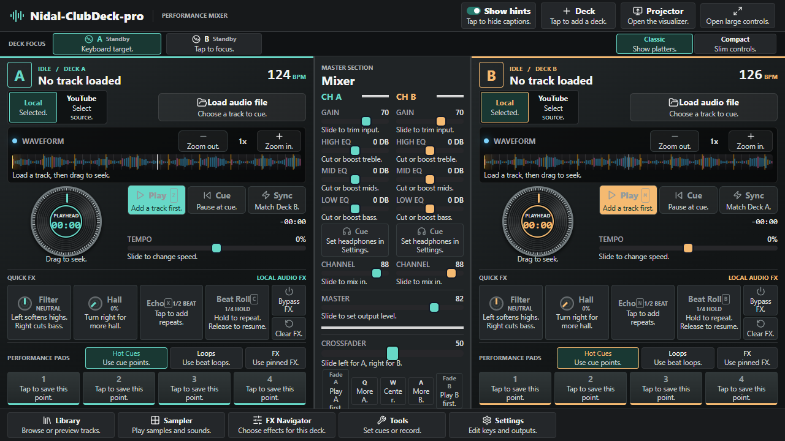

# Nidal-ClubDeck-pro

Version 1.6.0 of the portable Windows and browser DJ mixer. Stream embeddable YouTube videos directly on the decks or mix local audio with the classic jog platters and per-deck FX.

For a transition, move the crossfader to A. Load a stream on B and press Play when ready. Drag the fader toward B for a manual blend, or press **Fade B** for a three-second transition. Neither action starts or stops a deck. Touch the slider or use Q/W/A to take over a timed fade. The same fader works for local and mixed-source sets. YouTube does not expose its audio to the local FX or recorder. Videos that block embedded playback cannot stream inside the mixer.

## Run from source

Install the dependencies with `npm ci`. Run `npm run dev` for the browser mixer, or `npm run desktop:dev` for the Electron app.

## Build for USB

On Windows, run `npm run desktop:usb`. Extract the resulting ZIP to a USB drive and launch `Nidal-ClubDeck-pro.exe` from the extracted folder. Keep the adjacent files with it. See [the portable build notes](PORTABLE_USB.md).
